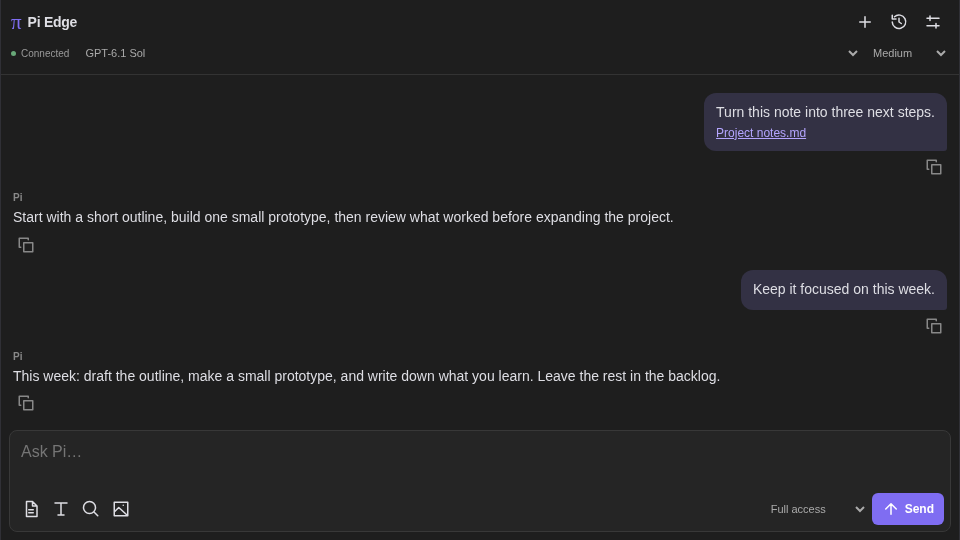
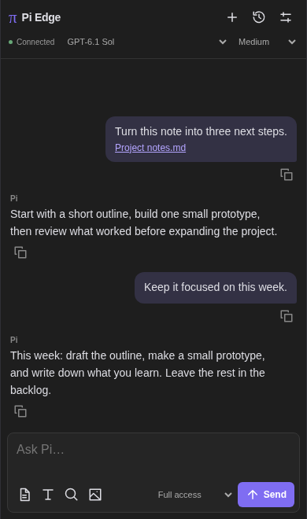
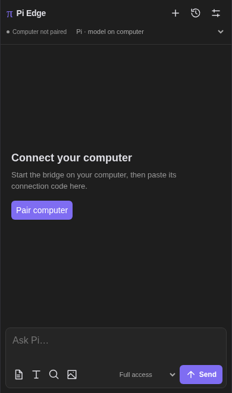

# Pi Edge

Chat with **Pi on your computer from Obsidian on your phone or desktop**. Attach notes and images, switch models, and reopen earlier conversations.

## Requirements

- **Computer:** Node.js 22+ and an installed, authenticated Pi CLI.
- **Phone or desktop:** Obsidian 1.7.2+ with Pi Edge installed.
- **Network:** both devices on the same Wi-Fi, or connected through a VPN such as **Tailscale**. Tailscale is optional; it is useful when away from home.

## Setup

**1. On your computer**, run this with the path to your vault:

```sh
npx --yes https://github.com/Anderbone/pi-obsidian-edge/releases/latest/download/pi-edge-bridge.tgz --cwd "/path/to/your/vault"
```

The bridge finds a Tailscale or local network address and prints a pairing code. Keep this terminal running and the computer awake.

**2. On your phone or desktop**, install [Pi Edge](https://community.obsidian.md/plugins/pi-edge), enable it, then run **Pi Edge: Pair computer** and paste the code. Open **Pi Edge: Open chat**. That’s it.

You can also scan the terminal QR code. In Pi Edge settings, **Test connection** shows green **Connected** when the bridge is reachable. Pair each device separately.

<details>
<summary>Prefer to let your agent set up the computer?</summary>

Copy this into your computer’s coding agent:

```text
Set up Pi Edge using https://github.com/Anderbone/pi-obsidian-edge
Read its README and user guide. Check that Node.js 22+ and Pi are installed
and Pi is authenticated. Ask me which vault to use if it is unclear.
Use the prebuilt bridge with npx; do not clone or compile the repository.
Use Tailscale if connected, otherwise my private LAN. Verify the bridge,
keep my existing pairing credentials, and show me the pairing code privately.
Tell me how to restart it and where to install the phone plugin:
https://community.obsidian.md/plugins/pi-edge
```

</details>

## Screenshots



| Phone chat | Pair your computer |
| --- | --- |
|  |  |

*UI previews with sample content.*

## Good to know

- Attach the current note, a selection, another vault note, or an image using the composer icons.
- History defaults to **500 conversations / 50 MB**. Change either limit in settings.
- **Full access** is the default, including file edits and shell commands. Choose **Read only** or **Read & write** as needed; these are not filesystem sandboxes.
- Messages go through your computer to your Pi model provider. Chat text may sync with your vault. Keep pairing codes private. No telemetry or hosted relay.

[User guide](docs/guide.md) · [Development](docs/development.md) · [Changelog](CHANGELOG.md) · [MIT license](LICENSE)
