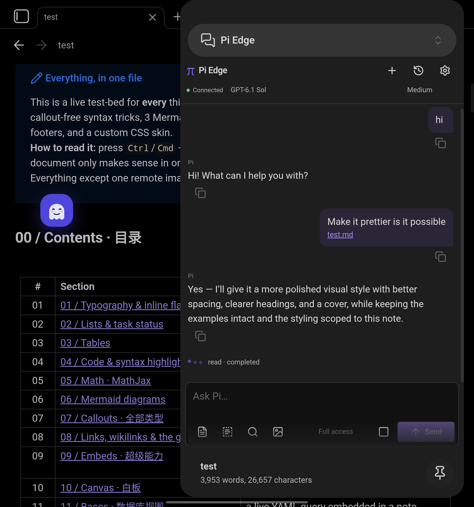
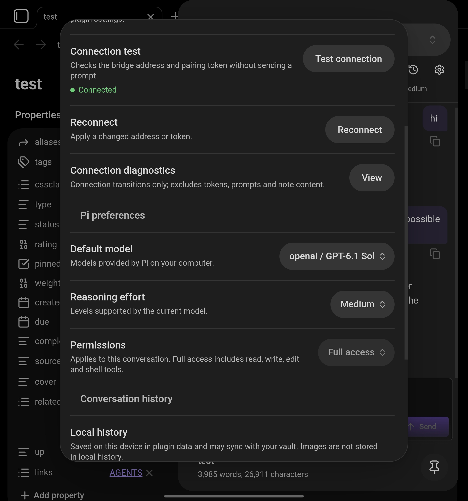

# Pi Edge

Chat with **Pi on your computer from Obsidian on your phone or desktop**. Attach notes and images, switch models, and reopen earlier conversations.

Pi is an AI coding assistant that runs on your computer. Pi Edge lets you talk to it inside Obsidian. A small program called the **bridge** connects the two. The bridge uses Pi Durable with SQLite to preserve conversations and recover unfinished tasks after a restart.

## Prefer to let your agent set up the computer?

Copy this into your computer’s coding agent:

```text
Set up Pi Edge using https://github.com/Anderbone/pi-obsidian-edge
Read its README and user guide. Check that Node.js 22.19+ and Pi are installed
and Pi is authenticated. Ask me which vault to use if it is unclear.
Use the prebuilt bridge with npx; do not clone or compile the repository.
Use Tailscale if connected, otherwise my private LAN. Verify the bridge,
keep my existing pairing credentials, and show me the pairing code privately.
Tell me how to restart it and where to install the phone plugin:
https://community.obsidian.md/plugins/pi-edge
```

## Before you start

You need a computer to run Pi, plus Obsidian on the phone or desktop where you want to chat.

- **[Download Node.js](https://nodejs.org/en/download):** install the LTS version on your computer (22.19 or newer). It includes `npx`, which runs the bridge command below.
- **[Install and set up Pi CLI](https://pi.dev/docs/latest/quickstart):** CLI means command-line app. Follow Pi’s guide on your computer to install it and connect a model provider. Open `pi` and check that you can send a message before continuing. Model access may require a subscription or API key.
- **[Download Obsidian](https://obsidian.md/download):** use version 1.8.7 or newer on the device where you want to chat.
- **Connect your devices:** start with both devices on the same Wi-Fi. To connect away from home, you can [install Tailscale](https://tailscale.com/docs/install) on both devices and sign in to the same Tailscale account. Tailscale is optional.

## Setup

### 1. Start the bridge on your computer

Open a terminal (Terminal on macOS/Linux, or PowerShell on Windows). Copy the command below, replace `/path/to/your/vault` with the full path to your Obsidian vault folder **on the computer**, and run it. A vault is the folder containing your notes. Keep the quotation marks, especially if the path contains spaces.

```sh
npx --yes https://github.com/Anderbone/pi-obsidian-edge/releases/download/bridge-0.3.4/pi-edge-bridge.tgz --cwd "/path/to/your/vault"
```

For example, a vault path might be `/Users/alex/Documents/My Vault` on macOS or `C:\Users\Alex\Documents\My Vault` on Windows. In desktop Obsidian, you can right-click a note and choose **Show in system explorer** to help find your vault folder.

The bridge connects to Pi and prints a **pairing code** and QR code. Keep this terminal running and the computer awake while you chat. You can restart the bridge later by running the same command.

### 2. Install Pi Edge in Obsidian

On your phone or desktop, open the [Pi Edge plugin page](https://community.obsidian.md/plugins/pi-edge), choose **Add to Obsidian**, then install and enable it. You can also find **Pi Edge** under **Settings → Community plugins → Browse**.

### 3. Pair and start chatting

Open Obsidian’s **command palette** (from the sidebar on mobile, or `Ctrl+P` on Windows/Linux and `Cmd+P` on macOS). Search for **Pi Edge: Pair computer**, select it, and paste the pairing code from your computer. Then run **Pi Edge: Open chat** from the command palette and send your first message.

You can also scan the terminal QR code to open pairing on supported devices. Pair each device separately and keep pairing codes private.

If you cannot connect, open Pi Edge settings and choose **Test connection**. Green **Connected** means the bridge is reachable. Check that your computer is awake, the terminal is still running, and both devices are on the same Wi-Fi or connected through Tailscale. See the [connection help](docs/guide.md#connection-help) for more options.

## Upgrading to 0.3.4

**Update the bridge on the computer as well as the Obsidian plugin.** The plugin alone cannot switch an already running bridge to the Pi Durable backend. The first time you enable this version on each device, Pi Edge opens these steps; reopen them from **Pi Edge settings → Computer bridge update** or the **Pi Edge: Computer bridge update** command. Acknowledging the notice only hides it on that device; it does not perform the update.

1. Wait for active tasks to finish, then stop the old bridge on the computer (`Ctrl+C` in its terminal, or stop its background service).
2. With Node.js 22.19 or newer, run the command below using the **same computer account and vault path** as before. Preserve your existing `--host`, `--port`, `--url`, `--tools` and `--state-dir` options. Omit `--backend cli` to use Pi Durable.

   ```sh
   npx --yes https://github.com/Anderbone/pi-obsidian-edge/releases/download/bridge-0.3.4/pi-edge-bridge.tgz --cwd "/path/to/your/vault"
   ```

3. If you use a background service, update its launch command to this archive version and restart the service. For a source checkout, pull the new code, run `npm ci`, then restart the existing bridge service. Run only one bridge for the same vault and state directory.
4. In Obsidian, open **Pi Edge settings → Test connection**, then open a conversation from **History** and send a message. **Connected** checks reachability and pairing; it does not confirm the bridge version. If you already run bridge 0.3.3 or newer, just perform this check; this plugin fix does not require a bridge reinstall.

Keep `~/.config/pi-obsidian-edge/` (including `token` and `durable/`), any custom state directory, and `~/.pi/agent/`. Pairing and mobile history are retained; pair again only if the address or token changed. Existing CLI chat context imports when first opened. Use `--backend cli` only if you need the previous runtime; Durable-only chats cannot be continued there.

## Screenshots

Chat beside your notes on a Galaxy Fold:



<details>
<summary>Connection test and settings</summary>



</details>

## Good to know

- Attach the current note, a selection, another vault note, or an image using the composer icons.
- Opening a different note starts a fresh chat with independent context. The top of the sidebar shows the note's full vault-relative path; click it to copy. Earlier chats remain available in History.
- Use **＋** for another independent chat, then **History** to search and resume chats. Running chats appear first with a Stop button; other chats show their last message time. Idle connections close after 24 hours without losing context. Phone disconnections do not stop running tasks; the Durable backend recovers unfinished work after a bridge restart. Switching notes or chats keeps tasks running.
- History defaults to **500 conversations / 50 MB**. Change either limit in settings.
- **Full access** is the default, including file edits and shell commands. Choose **Read only** or **Read & write** as needed; these are not filesystem sandboxes.
- Messages go through your computer to your Pi model provider. Chat text may sync with your vault. Keep pairing codes private. No telemetry or hosted relay.

[User guide](docs/guide.md) · [Development](docs/development.md) · [Changelog](CHANGELOG.md) · [MIT license](LICENSE)

## Backend and recovery

The default backend is Pi Durable 1.5.1. It reuses Pi model credentials and configuration. Each chat has a private SQLite database under `~/.config/pi-obsidian-edge/durable/<vault-hash>/`; use `--state-dir` to choose another private storage root. Keep this directory when upgrading. Existing CLI sessions are imported on first opening, without modifying their original files. Do not run two bridges against the same state directory.

Accepted submissions persist before acknowledgement. On startup, the bridge resumes unfinished chats without waiting for a phone. Interrupted read-only tools can rerun; interrupted writes and shell commands are reported as interrupted rather than blindly repeated. This is recovery, not a guarantee of exactly-once external side effects.

Use `--backend cli` to run the previous Pi CLI backend. The existing pairing token and mobile history remain unchanged. Durable-only conversations are not exported back into CLI session files, so use the Durable backend to continue those chats.
