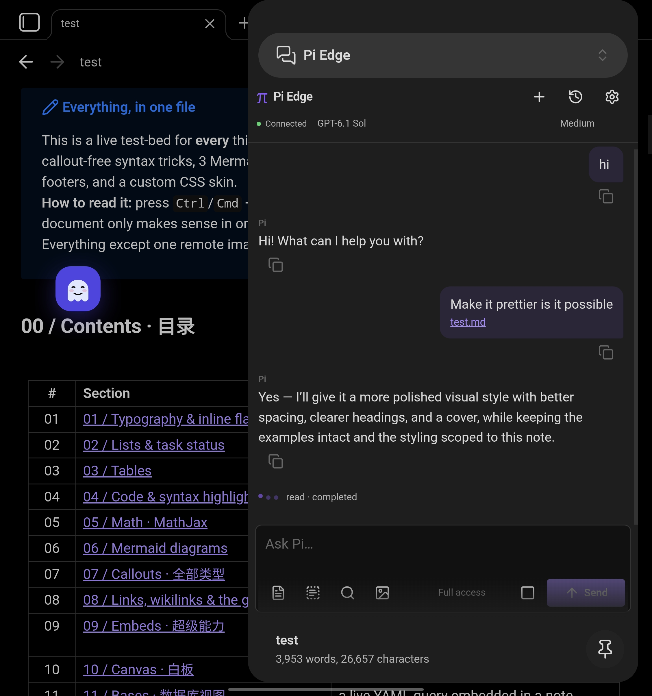
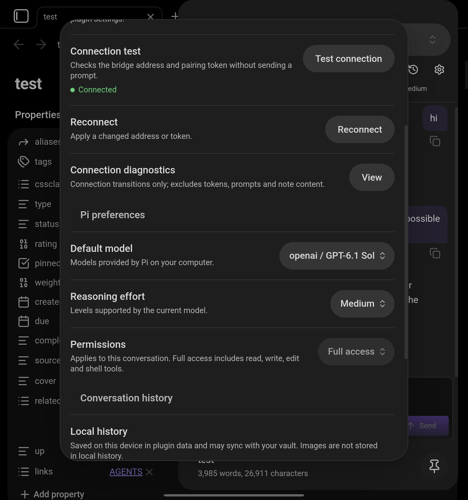

# Pi Edge

Chat with **Pi on your computer from Obsidian on your phone or desktop**. Attach notes and images, switch models, and reopen earlier conversations.

Pi is an AI coding assistant that runs on your computer. Pi Edge lets you talk to it inside Obsidian. A small program called the **bridge** connects the two.

## Prefer to let your agent set up the computer?

Copy this into your computer’s coding agent:

```text
Set up Pi Edge using https://github.com/Anderbone/pi-obsidian-edge
Read its README and user guide. Check that Node.js 22.19+ and Pi are installed
and Pi is authenticated. Ask me which vault to use if it is unclear.
Use the prebuilt bridge with npx; do not clone or compile the repository.
Use Tailscale if connected, otherwise my private LAN. Verify the bridge,
keep my existing pairing credentials, and show me the pairing code privately.
Tell me how to restart it and where to install the phone plugin:
https://community.obsidian.md/plugins/pi-edge
```

## Before you start

You need a computer to run Pi, plus Obsidian on the phone or desktop where you want to chat.

- **[Download Node.js](https://nodejs.org/en/download):** install the LTS version on your computer (22.19 or newer). It includes `npx`, which runs the bridge command below.
- **[Install and set up Pi CLI](https://pi.dev/docs/latest/quickstart):** CLI means command-line app. Follow Pi’s guide on your computer to install it and connect a model provider. Open `pi` and check that you can send a message before continuing. Model access may require a subscription or API key.
- **[Download Obsidian](https://obsidian.md/download):** use version 1.8.7 or newer on the device where you want to chat.
- **Connect your devices:** start with both devices on the same Wi-Fi. To connect away from home, you can [install Tailscale](https://tailscale.com/docs/install) on both devices and sign in to the same Tailscale account. Tailscale is optional.

## Setup

### 1. Start the bridge on your computer

Open a terminal (Terminal on macOS/Linux, or PowerShell on Windows). Copy the command below, replace `/path/to/your/vault` with the full path to your Obsidian vault folder **on the computer**, and run it. A vault is the folder containing your notes. Keep the quotation marks, especially if the path contains spaces.

```sh
npx --yes https://github.com/Anderbone/pi-obsidian-edge/releases/download/bridge-0.2.7/pi-edge-bridge.tgz --cwd "/path/to/your/vault"
```

For example, a vault path might be `/Users/alex/Documents/My Vault` on macOS or `C:\Users\Alex\Documents\My Vault` on Windows. In desktop Obsidian, you can right-click a note and choose **Show in system explorer** to help find your vault folder.

The bridge connects to Pi and prints a **pairing code** and QR code. Keep this terminal running and the computer awake while you chat. You can restart the bridge later by running the same command.

### 2. Install Pi Edge in Obsidian

On your phone or desktop, open the [Pi Edge plugin page](https://community.obsidian.md/plugins/pi-edge), choose **Add to Obsidian**, then install and enable it. You can also find **Pi Edge** under **Settings → Community plugins → Browse**.

### 3. Pair and start chatting

Open Obsidian’s **command palette** (from the sidebar on mobile, or `Ctrl+P` on Windows/Linux and `Cmd+P` on macOS). Search for **Pi Edge: Pair computer**, select it, and paste the pairing code from your computer. Then run **Pi Edge: Open chat** from the command palette and send your first message.

You can also scan the terminal QR code to open pairing on supported devices. Pair each device separately and keep pairing codes private.

If you cannot connect, open Pi Edge settings and choose **Test connection**. Green **Connected** means the bridge is reachable. Check that your computer is awake, the terminal is still running, and both devices are on the same Wi-Fi or connected through Tailscale. See the [connection help](docs/guide.md#connection-help) for more options.

## Screenshots

Chat beside your notes on a Galaxy Fold:



<details>
<summary>Connection test and settings</summary>



</details>

## Good to know

- Attach the current note, a selection, another vault note, or an image using the composer icons.
- History defaults to **500 conversations / 50 MB**. Change either limit in settings.
- **Full access** is the default, including file edits and shell commands. Choose **Read only** or **Read & write** as needed; these are not filesystem sandboxes.
- Messages go through your computer to your Pi model provider. Chat text may sync with your vault. Keep pairing codes private. No telemetry or hosted relay.

[User guide](docs/guide.md) · [Development](docs/development.md) · [Changelog](CHANGELOG.md) · [MIT license](LICENSE)
