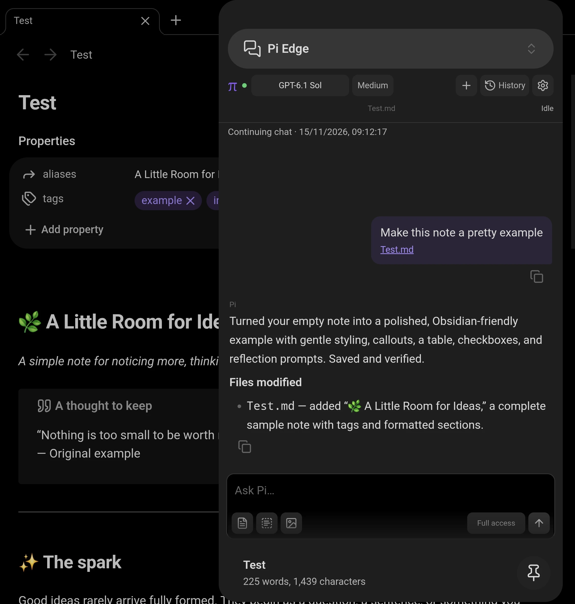
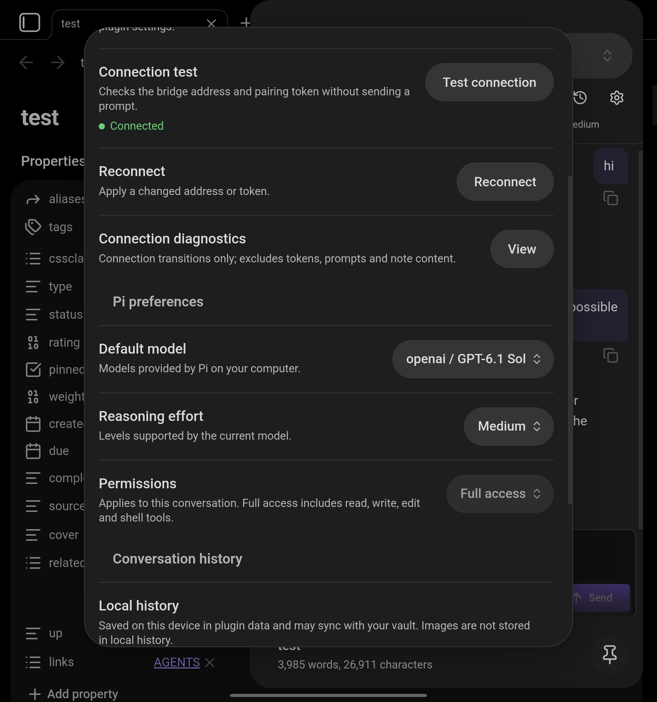

# Pi Edge

Use **Pi Durable from Obsidian** on your phone or desktop. Chat beside your notes, attach notes and images, switch models, and resume earlier conversations. Pi Durable runs on your computer and saves conversations in SQLite, with recovery for unfinished tasks after a restart.

<details>
<summary>Connection settings</summary>



</details>

## Setup

### 1. Configure Pi on your computer

- Install **[Node.js 22.19+](https://nodejs.org/en/download)**.
- [Install Pi and connect a model provider](https://pi.dev/docs/latest/quickstart). Open `pi`, sign in, and send a message to check your setup. The bridge reuses Pi’s credentials and model configuration.
- Connect your computer and Obsidian device to the same private network. For remote access, use [Tailscale](https://tailscale.com/docs/install) on both devices.

### 2. Start Pi Durable

Run this in your computer’s terminal, replacing the path with your Obsidian vault folder **on the computer**:

```sh
npx --yes https://github.com/Anderbone/pi-obsidian-edge/releases/download/bridge-0.3.6/pi-edge-bridge.tgz --cwd "/path/to/your/vault"
```

The bridge bundles Pi Durable and starts it by default; no separate Durable installation or service is needed. Keep the terminal running and the computer awake. Run the same command to restart it.

Optional configuration:

| Option | Purpose |
| --- | --- |
| `--model provider/model` | Set the starting model; you can also choose a model in Pi Edge. |
| `--host IP-or-hostname` | Choose the listening interface; defaults to Tailscale, then private LAN, then localhost. |
| `--port 8771` | Change the listening port. |
| `--state-dir "/path/to/private/storage"` | Change the private Durable storage root; defaults to `~/.config/pi-obsidian-edge/durable/`. |

### 3. Pair Obsidian

Install and enable **[Pi Edge](https://community.obsidian.md/plugins/pi-edge)** from **Settings → Community plugins → Browse** in Obsidian 1.8.7 or newer.

Run **Pi Edge: Pair computer** from the command palette and paste the pairing code printed by the bridge, or scan its QR code. Then run **Pi Edge: Open chat**. Pair each device separately and keep pairing codes private.

In Pi Edge settings, choose your **model**, **reasoning effort**, and **permissions**. Full access is the default and allows file edits and shell commands; permission presets are not filesystem sandboxes. The top of settings checks your connection automatically; a green **Connected** status confirms the bridge is reachable. See the [user guide](docs/guide.md) for connection help and advanced configuration.

<details>
<summary>Upgrading from an older version</summary>

## Upgrading to 0.3.6

**Already using Pi Durable with bridge 0.3.3 or newer?** Update the Obsidian plugin, test the connection, and send a message. No bridge reinstall is needed for 0.3.6.

**Using an older bridge or `--backend cli`?** Update both the plugin and the computer bridge:

1. Let active tasks finish, then stop the old bridge (`Ctrl+C` or stop its background service).
2. Run the command in step 2 above with Node.js 22.19+, using the **same computer account and vault path**. Keep your existing `--host`, `--port`, `--url`, `--tools`, and `--state-dir` options. Remove `--backend cli` to use Pi Durable.
3. For a background service, update its launch command and restart it. For a source checkout, pull the new code, run `npm ci`, and restart the bridge. Run only one bridge for the same vault and state directory.
4. In Obsidian, wait for the green **Connected** status in **Pi Edge settings**, then open an earlier chat from **History** and send a message. The connection status alone does not verify the bridge version or model access.

Keep `~/.config/pi-obsidian-edge/` (including `token` and `durable/`), any custom state directory, and `~/.pi/agent/`. Pairing and mobile history are retained; pair again only if the address or token changed. Existing CLI chat context imports when first opened, without modifying the original session files.

Updating the plugin or dismissing its upgrade notice does not update the computer bridge. Open **Pi Edge settings → Pair computer** for agent instructions or the expandable manual setup.

To use the previous runtime, add `--backend cli`. Durable-only chats cannot be continued with that backend.

</details>

Messages and attachments go through your computer to your configured model provider. Chat text may sync with your vault. No telemetry or hosted relay.

[User guide](docs/guide.md) · [Development](docs/development.md) · [Changelog](CHANGELOG.md) · [MIT license](LICENSE)
